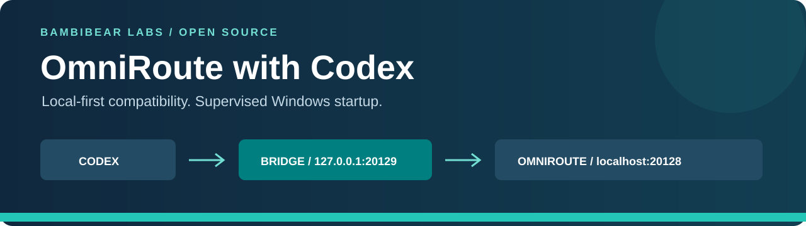
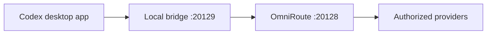

<div align="center">



# OmniRoute with Codex

### Your existing OmniRoute setup. A focused Codex compatibility fix. Reliable Windows bridge startup.

[](LICENSE)


[](https://github.com/Bambi-Bear-Labs/Omniroute-with-codex/actions)

**[Quick Start](#quick-start) · [Features](#key-features) · [How It Works](#how-it-works) · [User Guide](docs/user-guide.md) · [Documentation](#documentation) · [Troubleshooting](#troubleshooting)**

An independent, local-first integration by **[BambiBear Labs](https://github.com/Bambi-Bear-Labs)**.

</div>

---

> [!IMPORTANT]
> **This is a compatibility bridge, not OmniRoute itself.** Install and start OmniRoute separately, connect authorized providers, and obtain an OmniRoute API key. This project does not supply credentials, subscriptions, model access, or quota exemptions.

## Start here

| Your situation | Recommended guide |
| --- | --- |
| First installation | [Complete user guide](docs/user-guide.md) - prerequisites through the first response |
| Windows startup | [Windows setup](docs/setup-windows.md) - supervised sign-in and reboot checks |
| Keys or Codex settings | [Configuration](docs/configuration.md) - safe key setup and examples |
| Model picker or aliases | [Models and combos](docs/models-and-combos.md) - discovery, ordering, and opt-in |
| Reinstalling or migrating | [Recovery SOP](docs/recovery.md) - reuse, restore, migrate, roll back |
| Something fails | [Troubleshooting](docs/troubleshooting.md) - diagnose without breaking other models |

## Install with an AI coding agent

You can ask an AI assistant in plain language. For example:

> Install https://github.com/Bambi-Bear-Labs/Omniroute-with-codex for my Codex desktop app on Windows. Read `AGENTS.md` and `docs/ai-install.md`, inspect my existing setup, and show a no-change plan. Preserve my settings, use my existing OmniRoute API key from the environment, and ask which available model I want if unclear. Do not ask me to paste secrets. After authorization, configure the selected route and verify a real tool-result continuation.

For a private repository, the agent needs normal authorized GitHub access; do not paste a GitHub token into chat. The repository includes `AGENTS.md`, `CLAUDE.md`, `GEMINI.md`, and GitHub Copilot guidance. If an agent does not load project instructions automatically, explicitly ask it to read `AGENTS.md` and the AI guide.

For a terminal-only setup, ask for an **isolated Codex CLI profile** instead. The AI workflow uses read-only diagnostics, a dry run, an explicit apply step, backups, ownership checks, and scoped rollback. Actual provider sign-in, runtime permissions, and quota-using verification still require appropriate authorization.

```powershell
node scripts/doctor.mjs --json
node scripts/models.mjs --contains grok --limit 20 --json
node scripts/setup.mjs --mode cli --model 'grok-cli/grok-4.7' --dry-run --json
```

Replace the example model with one actually available from your server. Explicit `--mode desktop` changes the selected desktop provider/model; CLI mode leaves the main Codex config alone. [Full AI installation guide](docs/ai-install.md) · [Machine-readable manifest](install-manifest.json)

## Why this project exists

A provider can appear connected in OmniRoute and respond from another client, yet fail from Codex. One observed cause is an extra app-context record shaped as a tool output without a matching tool call:

```text
invalid "function_call_output" item: missing field `call_id`
```

The bridge repairs **the documented Grok context and search-history mismatches**, preserving real tool-call/result pairs. It also provides a supervised Windows sign-in task instead of relying on a late Startup-folder shortcut.

This is **not a general Responses API translator**. Outages, invalid keys, unavailable models, subscription limits, and unrelated schema errors still need resolution in the relevant service.

## Key features

| Feature | What you get |
| --- | --- |
| Targeted Grok compatibility | Known app-context outputs and unsupported search-history markers become lower-trust reference messages. |
| Other providers preserved | Non-target request bodies are forwarded unchanged. |
| Tool history preserved | Valid tool pairs stay intact; no invented call IDs. |
| Streaming | SSE bytes pass through without response parsing or buffering. |
| Local-only listener | Loopback on `127.0.0.1:20129`, forwarding to local OmniRoute. |
| Automatic bridge startup | Limited-privilege sign-in task with no configured delay. |
| Recovery | Active supervisor restarts an exited Node.js worker. |
| Custom Grok combos | Explicit alias opt-in; unrelated combos are not rewritten. |
| AI-ready installation | Read-only doctor, machine-readable plan, explicit apply, conflict checks and rollback. |
| Opt-in CLI profile | Keep the ordinary Codex configuration unchanged; choose desktop mode explicitly when desired. |
| No runtime npm dependencies | Implementation uses Node.js built-ins. |
| Recovery documentation | Config examples, diagnostics, catalogs, rollback, and reboot checks. |

## Quick start

### 1. Check the prerequisites

- Windows for the installer/task, with Windows PowerShell 5.1 or PowerShell 7.
- A supported **Node.js LTS release, version 22 or later**.
- Codex installed and launched once.
- **OmniRoute running on port `20128`**, with authorized provider connections.
- An OmniRoute API key and an available model ID.

Open `http://localhost:20128` for the OmniRoute dashboard. If it is offline, start your existing OmniRoute installation. This repository does not install or launch that server.

### 2. Download the project

Choose **Code > Download ZIP**, extract it, and open the extracted folder. Or clone it:

```powershell
git clone https://github.com/Bambi-Bear-Labs/Omniroute-with-codex.git
cd Omniroute-with-codex
```

Review scripts before running them. Do not run an installer from inside a ZIP.

### 3. Install the bridge once

Double-click **`Install-Bridge.cmd`**, or run from the repository root:

```powershell
& .\Install-Bridge.cmd
```

It discovers Node.js, copies the helper to local app data, runs tests, creates the current-user task, and checks health. Wait for:

```text
SUCCESS: automatic bridge startup is installed and running.
```

Preview without installing:

```powershell
& .\Install-Bridge.cmd -WhatIf
```

An existing task is not overwritten. After a Codex-only reinstall, [reuse a healthy helper](docs/recovery.md) instead of creating a duplicate.

<details>
<summary><strong>Using a custom Grok combo?</strong></summary>

Opt it in during a new installation:

```powershell
& .\Install-Bridge.cmd -GrokAliases 'my-grok-combo'
```

Create that routing alias separately in OmniRoute. A name in a config file does not create a connection or model entitlement. [Learn more](docs/models-and-combos.md).

</details>

### 4. Set your OmniRoute API key

Use a masked prompt in a normal PowerShell window:

```powershell
$secret = Read-Host 'OmniRoute API key' -AsSecureString
$key = [System.Net.NetworkCredential]::new('', $secret).Password
[Environment]::SetEnvironmentVariable('OMNIROUTE_API_KEY', $key, 'User')
$env:OMNIROUTE_API_KEY = $key
Remove-Variable key, secret
```

Use an **OmniRoute key**, not a provider password or OAuth token. A user environment variable is not a password vault. Do not print, commit, or screenshot it. Sign out/back in or reboot once so newly launched Codex inherits it.

### 5. Merge the Codex configuration

Back up `%USERPROFILE%\.codex\config.toml`. Put top-level keys before the first TOML `[table]`. Merge this provider section only once:

```toml
# Top-level keys:
model_provider = "omniroute"
model = "grok-cli/grok-4.7" # Example: verify your server's model IDs.

[model_providers.omniroute]
name = "OmniRoute"
base_url = "http://127.0.0.1:20129/v1"
env_key = "OMNIROUTE_API_KEY"
wire_api = "responses"
http_headers = { "x-omniroute-no-memory" = "true" }
```

Preserve your preferred model, working authentication choices, and unrelated headers. Do not replace a machine-specific config with another laptop's entire file.

Generate a snippet with your own absolute catalog path:

```powershell
& .\Show-ConfigSnippet.cmd
```

[Full configuration instructions](docs/configuration.md)

### 6. Validate a real response

```powershell
& .\Test-Bridge.cmd
```

This checks health and authenticated model discovery without generating a response. An optional small real request may consume quota:

```powershell
& .\Test-Bridge.cmd -TestGrok -Model 'grok-cli/grok-4.7'
```

Fully quit and reopen Codex. Test visible replies from Grok and another provider. A ping or connected badge is not enough.

### 7. Verify the laptop-restart experience

Restart Windows and sign in. The bridge task should start without a manual command. Make sure OmniRoute itself is also running, then open Codex and test a visible response.

> [!NOTE]
> **Only the bridge is automated here.** If you normally start OmniRoute in a terminal, continue unless its own startup is configured separately. Every request routed through `20129` needs both services.

[Complete reboot acceptance checklist](docs/setup-windows.md#reboot-acceptance-checklist)

---

## How it works



For eligible Grok requests, the observed `agent` records named `codex_apps_open_page` and `codex_apps_selected_page_part_N_of_N`, without a non-empty `call_id`, become user reference messages. Their original output is preserved and labeled as reference data, not a system/developer instruction or fabricated tool call.

Web-search history markers with `action.type = "other"` are also preserved as lower-trust reference metadata, because Grok rejects that replay variant after a tool turn. Accepted native search actions and the actual function-call results are left untouched. This continuation repair is included in version 0.1.1.
Other inputs, valid tools, model settings, and non-target bodies remain unchanged. [Read the exact transformation contract](docs/architecture.md).

## What gets installed

| Component | Location / behavior |
| --- | --- |
| Permanent helper | `%LOCALAPPDATA%\CodexGrokBridge` |
| Managed task | `Codex Grok Bridge - <WindowsUser>` |
| Identity | Current interactive user; limited privileges; no stored password |
| Laptop settings | Start on battery; do not stop on battery; unlimited runtime |
| Runtime config | Discovered Node.js path and optional Grok aliases |
| Logs | `managed-startup.log`, `bridge.stdout.log`, `bridge.stderr.log` |

The installer does **not** edit Codex config, change a model catalog, set API keys, sign into providers, modify the OmniRoute database, or create firewall rules.

## Endpoints at a glance

| Address | Purpose |
| --- | --- |
| `http://localhost:20128` | OmniRoute dashboard |
| `http://localhost:20128/v1` | Direct API / emergency fallback |
| `http://127.0.0.1:20129/v1` | Codex API through the bridge |
| `http://127.0.0.1:20129/__codex_grok_bridge_health` | Local health without an API key |

## Models and custom catalogs

Use IDs exposed by **your** OmniRoute server. The [example catalog](examples/omniroute-models.example.json) is a small starting point, not a model-availability promise.

Organize your picker by provider/preference while keeping array order and numeric priorities consistent. Restore combo definitions separately; this repository includes no personal account catalog or private routing rules.

[Model discovery, catalog setup, and aliases](docs/models-and-combos.md)

## Troubleshooting

<details>
<summary><strong>All models fail after a restart</strong></summary>

Check bridge health, task state, and OmniRoute on `20128`. Every request sent to `20129` needs both services. Use the managed sign-in task, not an extra Startup-folder shortcut. [Diagnostics](docs/troubleshooting.md).

</details>

<details>
<summary><strong>The browser says Authentication required</strong></summary>

An API URL is not a dashboard. Your browser sends no API-key header. Use the OmniRoute dashboard or bridge health URL; do not disable authentication or put a key into the browser URL.

</details>

<details>
<summary><strong>Grok still reports a missing call_id</strong></summary>

Confirm the bridge URL, documented record scope, and alias opt-in for custom Grok combos. Reopen Codex after config edits. This project does not repair every Responses schema error.

</details>

<details>
<summary><strong>The task already exists</strong></summary>

Reuse a healthy helper after a Codex-only reinstall. For complete repair, follow the [scoped recovery procedure](docs/recovery.md). Do not create duplicate tasks or stop every Node.js process.

</details>

[Full troubleshooting table](docs/troubleshooting.md)

## Documentation

| Guide | What it covers |
| --- | --- |
| [AI installation](docs/ai-install.md) | Agent instructions, dry run, explicit apply, validation and rollback |
| [User guide](docs/user-guide.md) | First-time setup, daily use, and a visible response |
| [Windows setup](docs/setup-windows.md) | Installation, task settings, reboot acceptance |
| [Configuration](docs/configuration.md) | API key, TOML, catalog, and aliases |
| [Models and combos](docs/models-and-combos.md) | Discovery, picker organization, custom routes |
| [Architecture](docs/architecture.md) | Normalization scope, streaming, process ownership |
| [Troubleshooting](docs/troubleshooting.md) | Error-by-error checks |
| [Recovery SOP](docs/recovery.md) | Reinstall, migration, backup, rollback |
| [Security policy](SECURITY.md) | Trust boundaries and private reporting |

## Development and verification

```sh
npm test
npm run check
```

Tests use local mock servers, not paid APIs. CI is configured for Windows/Linux and Node.js 22, 24, and 26, plus Windows script parsing and installer preview. CI does not validate subscriptions, real model availability, or a laptop reboot.

## Scope and limitations

- Windows automation is Windows-only; the Node.js core can run manually elsewhere.
- Compressed or larger-than-threshold bodies pass through unchanged and may still trigger the original error.
- Ports are fixed defaults. This single-user helper is not an internet-facing gateway.
- Provider outages, quotas, unavailable models, and account access are outside the scope.
- Compatibility can change. Repeat response/reboot checks after material upgrades.
- Use only authorized accounts and comply with provider terms.

## Support and contributions

[Open an issue](https://github.com/Bambi-Bear-Labs/Omniroute-with-codex/issues) with versions, synthetic reproduction steps, and redacted diagnostics. Never post credentials, private prompts, account exports, or personal paths.

[Contributing](CONTRIBUTING.md) · [Code of conduct](CODE_OF_CONDUCT.md) · [Changelog](CHANGELOG.md)

## License and acknowledgements

[MIT](LICENSE). Copyright © 2026 Bambi-Bear-Labs.

This project complements OmniRoute and does not redistribute Codex or OmniRoute. See the [OmniRoute reference README](https://github.com/ChrisCompton/omniroute) for the broader gateway project. This README follows a similar user-oriented structure, not its product claims or implementation.

**Unofficial, independent integration.** Not affiliated with, sponsored by, or endorsed by OpenAI, xAI, or OmniRoute maintainers. Their trademarks belong to their owners.
